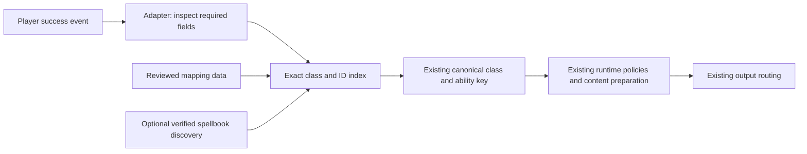

# Ability detection architecture proposal

**Milestone 1 status, 2026-11-06:** the owner approved and implementation now
provides the static mapping foundation plus Shaman 325/547 alongside the existing
two Paladin IDs. See [implementation and acceptance](ability_detection_milestone_1.md).
The proposal below records the original investigation baseline; discovery and
broader mappings remain deferred. The test build awaits live acceptance.

Design snapshot: 2026-11-06, based on `diagnostics/live-client-ability-events`
at `76cfebf`. **Original investigation and proposal.** No mappings,
event handling, content, settings, persistence, or output policies change here.

## Recommendation

Use a data-driven, class-scoped exact spell-ID resolver. Keep the current guarded
`UNIT_SPELLCAST_SUCCEEDED` adapter and canonical ability keys. Expand a reviewed
allowlist in small batches, with evidence for each emitted ID and supported
mechanism. Treat spell names as diagnostic/identity research metadata initially.

Allow a later hybrid extension: a bounded, session-only player-spellbook scan
may discover IDs for **individually approved ability families**, using tested
identity relationships. Discovery starts as observation only. It must not enable
every catalogue entry or promote same-name spells automatically. If Forever
cannot expose a safe, unambiguous family relationship, explicit rank IDs remain
the supported solution. The design covers every current catalogue identity;
it does not promise a detector for deferred mechanisms.

The companion [verification inventory](audits/ability_detection_verification_inventory.csv)
contains one row for each of the **474 current canonical abilities**. All require
some verification: even the two mapped Paladin abilities lack recorded RPHelper
live acceptance of their complete detection/policy/output path and other ranks.
Candidate columns are research evidence, never an importable production list.

## 1. Inspected architecture and evidence

### Identity and content

The active TOC, `Data/Abilities/*.lua`, `Core/Content.lua`,
`UI/LibraryData.lua`, and the [canonical content export](content_inventory/events.csv)
establish the current inventory. `RegisterAbility(class, key, nil)` can define
an empty shipped pool; `RegisterAbility(class, key, entry)` adds a reaction.
The catalogue has **282 populated abilities, 192 empty definitions, and 783
shipped ability reactions**. Archives excluded by the TOC are not active abilities.

| Class | Canonical abilities | With shipped reactions | Shipped reactions |
| --- | ---: | ---: | ---: |
| Druid | 58 | 13 | 28 |
| Hunter | 58 | 46 | 141 |
| Mage | 60 | 52 | 128 |
| Paladin | 54 | 43 | 88 |
| Priest | 55 | 44 | 133 |
| Rogue | 38 | 2 | 2 |
| Shaman | 57 | 45 | 188 |
| Warlock | 53 | 25 | 54 |
| Warrior | 41 | 12 | 21 |
| **Total** | **474** | **282** | **783** |

Three identities must stay separate:

- `(class, canonical key)`, such as `(SHAMAN, HEALING_WAVE)`, selects the ability
  pool and settings at `RPHelperDB.abilities[class][key]`.
- `ability:SHAMAN:HEALING_WAVE` is the scoped Library/export event ID. It is not a
  client spell ID or a generic `Runtime.TriggerConfigKey` alias.
- Permanent `default:ability:…` and `custom:…` reaction IDs identify individual
  records and their exclusions, weights, and modified copies.

Ranks belong to client identity resolution. They must not create new event IDs,
reaction pools, settings records, or canonical keys. Empty shipped pools can
contain character-authored Custom content; population is a prioritization signal,
not a permanent detection eligibility rule.

### Current detector and downstream consumers

`Core/RuntimeAPI.lua` owns guarded ordinary event registration, secret inspection,
player filtering, and `AbilitySpellIDs`. Its entire allowlist is:

| Class | Exact event ID | Existing canonical key | Current evidence |
| --- | ---: | --- | --- |
| PALADIN | 19750 | FLASH_OF_LIGHT | Prior third-party Forever success observation; mocked production path |
| PALADIN | 20288 | SEAL_OF_RIGHTEOUSNESS | Prior third-party Forever success observation; mocked production path |

`ClassifySpellcastSucceeded(unitTarget, castGUID, spellID, class)` accepts only
an exact readable `player`, a readable finite positive integer ID, and a
readable supported class. Inspection must succeed and return exactly false for
each required field. GUIDs and extra cast-bar fields are ignored. Unknown IDs
return `unmapped` before content preparation.

`Core/Runtime.lua` obtains player class, calls that classifier, validates the
returned canonical definition, and enters the shared reaction coordinator.
During opt-in capture only, it additionally calls `GetDiagnosticSpellName` with
the already inspected ID. Name failure does not prevent an ID match. Diagnostic
text is sanitized and truncated for display; that text is unsuitable as an
identity key. No spell names or rank labels arrive in the success payload.

`UI/LibraryData.lua` and `scripts/export_content_inventory.py` also consume
`RuntimeAPI.AbilitySpellIDs`. A future resolver must preserve that authoritative
static view, or update these consumers together. Otherwise an ability can react
while the Library reports no detector, or an export can mistake character-local
discovery for bundled support. The current UI reports support at ability level;
it does not establish coverage of every rank.

### Live findings and their limits

The owner reports first live-client testing on **Interface 16001**: success
events are delivered/readable; Lightning Shield **325** and Healing Wave Rank 3
**547** are received but `unmapped`. Both identities have authored reactions
(six and five respectively). This matches the two-ID allowlist; raising chance
cannot repair the mapping gap. These are owner-reported observations in the task,
not new captures performed for this design. Raw records, exact client build,
locale, combat/activity matrix, and repeated-cast/failure results were not
supplied. Do not infer those details, full reaction success, or other ranks.

The existing [diagnostic guide](live_client_detection_diagnostics.md) describes
the available capture method, not this session's saved evidence. Its unresolved
questions and older audits predate the owner's report. Delivery/readability now
has positive evidence for the reported samples; general combat readability,
special mechanisms, duplicate behaviour, and output acceptance remain open.

The [October spell-ID audit](audits/ability_spell_mapping_audit.md) covers 297
historical content-bearing pairs/841 reactions; the
[coverage audit](audits/forever_ability_coverage_audit.md) covers 465 earlier
canonical abilities/842 reactions. Neither is the current 474/783 baseline.
The [runtime integration inventory](audits/runtime_ability_integration_inventory.csv)
uses the current 474 identities but combines empty pools and mechanism exclusions
in category E. Its categories are retained as historical evidence, not reused
as mechanism decisions. There are 266 exact current-key matches in the older
297-row mapping audit; absent/renamed rows need reconciliation rather than a
blind join or bulk import.

The nine later `docs/audits/<class>_beta_reconciliation.md` reports and companion
CSVs add spellbook ranks/mechanics and approved catalogue dispositions. They
explain the current successors, Priest racial section, and empty definitions.
For example, the [Shaman disposition](audits/shaman_beta_reconciliation.md#approved-implementation-disposition)
restores Elemental Mastery as active; the October removal finding is superseded
for identity, while its current IDs/events remain unverified. The
[Hunter report](audits/hunter_beta_reconciliation.md) describes Tame Beast as
channeled and Intimidation as directly activated; the
[Warlock report](audits/warlock_beta_reconciliation.md) describes Wrack as
channeled. Newer catalogue approval still does not approve runtime mappings.

### API research checked for this design

The current community-generated Forever declarations identify build **70790**,
Interface **16001**, export date **2026-11-05**. They still declare success payload
positions `(unitTarget, castGUID, spellID, optional castBarID)`.
This is documentation evidence, not proof of the owner's client build or access
permission. [Forever Unit declarations](https://raw.githubusercontent.com/Atraeau/WoW-Addons/main/docs/api/Units-Combat-PvP/Unit.md).

The same export declares player spellbook enumeration, item metadata,
base/override helpers, and `SPELLS_CHANGED`. Item metadata distinguishes spell
IDs from flyout/pet action IDs and includes passive/off-spec flags; skill lines
provide offsets/counts. [Forever spellbook declarations](https://raw.githubusercontent.com/Atraeau/WoW-Addons/main/docs/api/Spells-Auras-Talents/C_SpellBook.md).

Upstream Blizzard definitions annotate spellcast success as potentially secret,
and spellbook lookup as capable of returning nothing. Their mutable retail
`live` branch is comparison evidence, not Forever-specific access assurance.
[Blizzard Unit definitions](https://raw.githubusercontent.com/Gethe/wow-ui-source/live/Interface/AddOns/Blizzard_APIDocumentationGenerated/UnitDocumentation.lua),
[Blizzard spellbook definitions](https://raw.githubusercontent.com/Gethe/wow-ui-source/live/Interface/AddOns/Blizzard_APIDocumentationGenerated/SpellBookDocumentation.lua).
Spell-name lookup can also return nothing; a declared callable function is not
a safe classification contract. [Blizzard spell definitions](https://raw.githubusercontent.com/Gethe/wow-ui-source/live/Interface/AddOns/Blizzard_APIDocumentationGenerated/SpellDocumentation.lua).

These mutable sources were inspected on 2026-11-06. Existing numerical/rank
inventories retain their October provenance; no current spell database was
re-downloaded or revalidated. Declaration presence, registration, delivery,
readability, semantic identity, and reaction output are independent evidence.

## 2. Detection strategy comparison

| Strategy | Accuracy and compatibility | Restrictions and cost | Maintenance and update resilience | Decision |
| --- | --- | --- | --- | --- |
| Explicit class + ID, every accepted rank listed | Deterministic, locale-independent; exact activation/effect roles can be reviewed. Only listed ranks work. | Existing guards; O(1) event lookup, O(accepted IDs) memory; no extra event-time API calls. | New/changed ranks require data review. Unknown IDs safely miss reactions. Known IDs also need semantic rechecks after relevant client changes. | Immediate foundation. |
| Event-ID-to-name lookup, then curated name-to-key resolution | Potentially groups ranks; names can collide, be localized, refer to effects, or change. SUCCEEDED supplies no name itself. | Adds lookups/string processing on events, with independent nil/error/secret risks. Diagnostic readability does not validate runtime use. | Needs reviewed locale aliases and ambiguity rules; typos/fuzzy matching create false positives. | Do not use as a production fallback. |
| Spellbook scan and cached learned IDs | Discovers a character's current book, not canonical semantics or emitted-event behaviour. Cannot cover unlearned spells/ranks. | O(book slots) guarded scan, O(discovered IDs) session memory; O(1) event lookup. APIs, fields and refresh events need client tests. | Refresh after learning/respec/overrides; scan omissions must not erase catalogue identities. Names alone remain ambiguous. | Useful evidence collection; insufficient as a standalone resolver. |
| Verified static IDs + family-specific safe discovery | Static fallback remains predictable. Curated identity/mechanism rules constrain discoveries. | Same event guards and lookup; bounded out-of-combat refresh and cache invalidation add complexity. | Can reduce rank maintenance if a reliable family relationship exists; explicit data remains necessary where it does not. | Preferred extension only after evidence justifies it. |

An English-only bundled UI/content policy does not establish the client's spell
locale. Exact numeric mappings work independently of locale. Runtime names would
need their own tested locale/readability contract even if every diagnostic
sample happened to show English text. No matching by substring, Lua pattern,
tooltip text, inferred underscore keys, or stripped rank suffix is acceptable.

## 3. Proposed identity and data contract

The optional discovery arrow is a future extension, initially disabled; neither
content nor output code queries the spellbook. Unknown/restricted input stops
at the adapter. A safely resolved identity represents a successful player
activation, not its hit/heal/buff outcome or target.

### Reviewed static records

In a later implementation, move the allowlist out of adapter logic into one
small bundled mapping-data module (for example `Data/AbilitySpellMappings.lua`).
Keep one module until size justifies class files. The TOC would load it before
classification is used; mapping validation must run after canonical definitions
are registered. Do not intermingle client IDs with authored sayings.

Use one record per **class + emitted spell ID**, with these fields:

| Field | Meaning |
| --- | --- |
| `class`, `ability` | Exact existing canonical pair; must exist in `RPHelper.Ability`. |
| `spellID` | Exact readable-success ID authorized for this record. |
| `mechanism` | Reviewed `player_success` activation contract; deferred mechanisms cannot enter this index. |
| `rank` / `variant` | Optional evidence metadata, never runtime matching logic. |
| `evidenceRef` | Stable reference to a capture/review entry, including date, build, Interface and tested contexts. |

A source record list permits validation of duplicate IDs before building the
lookup table; a Lua table keyed directly by ID would silently overwrite duplicate
declarations. Compile it into the existing `AbilitySpellIDs[class][spellID] = key`
shape. Reject invalid IDs, unknown canonical pairs, conflicting class/ID records,
missing evidence and unsupported mechanisms in offline validation. Never resolve
collisions using iteration order. Same IDs in different class scopes are separate
records. The initial data extraction must preserve exactly the existing two
mappings and their inherited evidence qualification; it must not relabel them as
RPHelper-live-verified.

Keep detailed candidate/rejected/helper evidence in research CSVs, outside the
addon load path. Do not add a second runtime database of unapproved IDs, automatic
downloads, or arbitrary user-supplied mappings. Future expansion normally adds
reviewed data and fixtures, without changing classifier branches.

### Evidence progression and rank handling

Track progress **per emitted ID**, separately from family identity, mechanism
compatibility, and content eligibility:

1. Candidate: class/name/rank source supports investigation; not executable.
2. Learned identity observed: readable player-book record links the ID to the
   intended ability; event delivery/meaning still unverified.
3. Success observed: exact readable player ID captured, with ability/rank and
   context recorded; a single sample is not full acceptance.
4. Reviewed for inclusion: mechanism, aliases, negative tests and supported
   contexts accepted; separately authorized mapping change can use this ID.
5. Regression checked: current build rechecks or explicitly records inherited
   evidence limitations after relevant updates.

Historical third-party observations remain marked third-party. The owner's 325
and 547 reports reach reported success observation only, pending capture details
and review. Production presence is another field, not an evidence level.

Multiple approved rank IDs resolve to the same existing key. Do not infer numeric
ranges, rank ordering from IDs, or completeness from a source's rank labels.
Healing Wave's historical candidates include `331;332;547;913;939;959;8005;10395;10396;25357`;
only **547** has the owner's report here. Lightning Shield candidates include
`324;325;905;945;8134;10431;10432`; **325** is reported, with Rank 2 in the older
dataset, while the owner did not supply a shield rank label. Other ranks remain
candidates. Rank upgrades and deliberate downranking must be tested separately.

Do not assume `C_Spell.GetBaseSpell` or spellbook base/override helpers normalize
all classic ranks. Base, learned, override, aura, triggered-effect and actual
event IDs can differ. Flash of Light/Holy Light helper variants and Lightning
Bolt proc copies illustrate why matching a name or base family is insufficient.

### Forever identities, names and aliases

The active catalogue is the identity authority for this task. For example it
already uses `BANE_OF_AGONY`, `BANE_OF_DOOM`, `SUBJUGATE_DEMON`, `BLADE_FLURRY` and
`FIRE_NOVA`; old audit keys include their historical predecessors. Link historical
evidence explicitly to these current pairs, while reviewing event identity anew.
Do not restore archived keys or migrate settings as part of mapping work.

Review every additional Forever variant as a candidate record. New rank/talent
IDs can reuse an existing key only after semantic equivalence is established.
New mechanically distinct abilities require a separately reviewed catalogue
decision first. Fire Nova Totem is not an alias for Fire Nova. Paladin
`JUDGEMENT` stays that canonical spelling even if the client says Judgment;
Warlock `EYE_OF_KILROGG` likewise must not be silently renamed by pluralization.
The inventory leaves Paladin Salvation/Revoke/Mass Salvation and Mage Arcane
Wrath/Frost Blast without invented historical-ID associations.

Frost Blast must remain distinct from Frostbolt, and Polymorph Pig/Turtle from
base Polymorph. Rogue Poisons-tab creation recipes are distinct from applying
the resulting item or its later proc. Shifting Power already inherited two
Tiger's Fury reactions by approved catalogue migration; their roar wording needs
manual content review before wider detection, without rewriting it here. These
examples come from the later class reconciliations, not generic name similarity.

If names later assist discovery, maintain explicit `(class, locale, exact raw
name) -> reviewed family` aliases, with any required variant/race constraints.
An alias is identity evidence, not authorization to classify every ID returning
that name. Unsupported locales, competing identities, changed activation
semantics, and unknown names produce no discovery. Do not use display-sanitized
diagnostic strings. Never transfer sayings between mechanically different
abilities automatically.

Priest racial candidates need learned race/variant checks; older racial status
must not override current universal Fear Ward/Devouring Plague catalogue
identities. General-tab abilities remain excluded from automatic scanning scope
unless an individual exception is reviewed under the
[reconciliation contract](forever_ability_reconciliation.md). Player casts that
summon/manage pets are distinct from pet-owned attacks. Accepting `pet` success
events would change attribution and is outside this proposal.

## 4. Optional discovery and cache lifecycle

This section defines a testable extension, not permission to implement it now.
First implement a diagnostic experiment proving the API contract on Forever.
Do not assume export presence or auto-generated usage examples are executable
instructions; use the actual client enums and tested signatures.

The proposed scan uses `C_SpellBook.GetNumSpellBookSkillLines`,
`GetSpellBookSkillLineInfo`, `GetSpellBookItemInfo` and
`Enum.SpellBookSpellBank.Player`. For reviewed class skill lines, enumerate
`itemIndexOffset + 1` through `itemIndexOffset + numSpellBookItems`. Never rely on
slot positions across refreshes or English tab labels as stable identities.
If safe class-line identification is unavailable, skip discovery. Do not scan
the pet bank. General-tab exceptions need explicit policies.

Check capability presence, protect calls, inspect returned containers before
indexing, and inspect required fields before comparisons/arithmetic/string work.
Require valid item type, readable positive integer `spellID`, established learned
status, nonpassive and active-spec eligibility. Skip future/unlearned, off-spec,
flyout, pet-action, auto-attack and unsupported entries. `actionID` cannot be
substituted indiscriminately for `spellID`. If the tested client needs another
known-spell check to exclude future entries, verify that API and its return value;
neither a tooltip nor database presence proves learned status. Unused icons,
descriptions or rank subtext need not be read or inspected.

Discovered IDs may enter an effective index only when **all** of these hold:

- The canonical family has an explicit, separately reviewed discovery policy
  for the tested API/build behaviour and ordinary activation mechanism.
- The item is safely identified as a learned player spell in approved scope.
- A tested base/override relationship to a curated seed ID, or another specifically
  reviewed family identity rule, establishes semantic membership. A name match
  alone cannot qualify. An override must also preserve activation semantics.
- The policy establishes which learned/override IDs can appear in SUCCEEDED.
  Until that relationship is verified, the discovered number is observation-only.
- No competing canonical family claims the class/ID pair. Conflicting discovery
  entries are rejected and reported with fixed reason codes; discovery never
  overrides an authoritative static record.

This provides an explicit future route for previously unlisted ranks **only
within an approved family contract**. If relationships prove unreliable for a
family, require individual event-ID review instead. Broad name-based automatic
rank enablement is rejected. Discovered identities never enable a deferred
channel/form/passive mechanism.

Proposed lifecycle:

1. Start each login/reload with static mappings and an empty discovery cache.
   Key caches to current character class, client build, locale and an in-session
   spellbook generation; never serialize them to `RPHelperDB`.
2. Run at most one bounded scan after safe initialization, outside combat.
   Validate slot/line counts and offsets with explicit implementation limits
   (initial experiment: at most 64 lines and 2,048 total slots; tune from measured
   books). Exceeding a bound fails the dynamic scan, preserving static support.
3. Guard registration of `SPELLS_CHANGED`. Immediately invalidate dynamic results
   when the book changes; coalesce changes into one dirty generation. Rescan at
   a safe out-of-combat point using the existing combat-exit notification and a
   guarded login/initialization opportunity. Failure disables only discovery.
   If no verified safe refresh opportunity arrives, remain on static mappings;
   do not retain stale dynamic results or poll for a refresh.
4. Stage results, then atomically publish only a valid, current-generation scan.
   Discard partial/failed/stale scans. Readability errors skip unsafe items;
   unreadable enumeration metadata aborts the scan. Static support survives both.
5. Observe whether rank learning, respec and temporary overrides actually cause
   invalidation. If `SPELLS_CHANGED` is insufficient, test specific change events
   before adding subscriptions. Families with unobservable changes stay static.
6. Empty or delayed text cannot establish aliases. Leave that discovery unresolved
   until a verified notification or explicit diagnostic retry; no polling/retry
   timer. Capture need not store arbitrary names or full spellbook dumps.

The event path always validates its fresh payload and performs exact lookup.
Classification never scans, calls a name API, normalizes a base ID, or uses a
cache to recover an unreadable event ID. The existing optional diagnostic name
lookup stays independent. A readable known ID can match even if that lookup is
unavailable. Unknown readable IDs safely miss reactions.

Keep bundled mapping coverage available to the offline exporter. If discovery
is later enabled, expose a narrow resolver query for the Library that reports
bundled versus current-character support and invalidates with the cache. The
exporter must continue to describe shipped mappings reproducibly; it must not
require client APIs or export a character's transient discoveries.

## 5. Safety and unchanged runtime contract

Missing/failing `issecretvalue`, an inspection result other than exactly false,
unreadable class/unit/ID, malformed numeric IDs, wrong units, unsupported
mechanisms and unknown identities produce no ability reaction. Inspect before
indexing, formatting, equality tests, arithmetic or normalization. `pcall` catches
errors; it does not make a returned secret value readable. Never stringify raw
errors/payloads. Use bounded fixed diagnostic reasons and retain only inspected
values. Ignore unused GUID/cast-bar fields, even if restricted.

No alternate lookup may reconstruct a restricted event's identity. No combat
log, combat text, aura inference, target correlations, action hooks, polling,
secure-action replacement, or macro fallback is proposed. Do not add a pending
cast machine. No duplicate suppression is justified by current evidence; if one
activation produces multiple success notifications, defer that mechanism or
separately review a bounded supported solution. Identical IDs/timing alone
cannot distinguish duplicates from legitimate repeat activations.

The resolved `(class, key)` enters the existing coordinator unchanged:

- Preserve master/event switches, sparse ability chance replacing global chance,
  default 5%, shared global cooldown (default 20 seconds), and Priority bypass of
  that cooldown only. There is **no existing per-ability cooldown** to migrate.
- Preserve the optional encounter quota and successful-dispatch-only accounting;
  out-of-combat abilities neither check nor consume encounter quota. Suppression,
  no eligible content, failed selection/dispatch, or invalid policy input spends
  neither cooldown nor quota.
- Preserve eligibility filtering, stable built-in/custom reaction IDs and weights,
  character custom content, exclusions, modified copies and Druid Say suppression.
  Do not invent cast-target context; target-dependent content can remain ineligible.
- Preserve world-local Say, dungeon SAY or character-local preference, native
  emote/custom-emote routing, and unconditional raid/unknown-activity suppression.
- Keep `RPHelperDB` per character, schema v2 and its existing keys. Mapping/cache
  changes need no SavedVariables schema migration or new persisted diagnostics.
  Existing approved catalogue migrations continue unchanged; this proposal adds
  no migrations or new interpretation of archived keys.

Channels, forms/stances, queued melee, automatic attacks/repeats, passive procs,
reticles/empower, remote viewing and pet-owned execution retain their existing
unsupported status. Some remain in the catalogue with sayings. An excellent ID
match does not establish a compatible activation contract. Catalogue inclusion
does not override this boundary, nor does it authorize offensive-crit detection.

## 6. Verification inventory and method

[ability_detection_verification_inventory.csv](audits/ability_detection_verification_inventory.csv)
contains every current `category=Ability` row from the canonical export, sorted
by class/key, including empty definitions and the two existing mappings. Counts,
event IDs, source lines and production IDs come from that export, checked against
the active TOC with `python3 scripts/export_content_inventory.py --check`.
Historical source roots `RPHelper/` or `RPHelper Forever/` resolve to the current
`RPHelperForever/` root; only this new inventory normalizes its source locators.

Historical evidence is joined first by exact class/canonical key to the coverage
CSV. Where no key matches, a class-scoped exact name comparison after removing
punctuation/spacing links research rows, including racial rows. This is an
offline evidence cross-reference, **never a proposed runtime matching rule**.
Its join type and original key/scope/classification are retained so reviewers can
see rename/racial associations and outdated `Missing` labels. Candidate IDs are
the union of IDs in the linked coverage, older mapping and later class-beta
records, not promoted or synthesized. The earlier mapping audit is linked by
current key or the linked row's historical key where present.
The class-beta CSV is linked by exact canonical key, falling back to the same
normalized exact-name comparison within that class; its original identity,
scope, mechanics and ranks are retained. All 474 rows have a beta cross-reference.
Rank records, source URLs and earlier third-party success IDs retain provenance;
source-specific candidate membership and helper warnings remain in the linked
original inventories.

The coverage join yields 393 exact canonical matches, 74 name associations and
seven without a coverage row. Fourteen current abilities have no linked numeric
candidates: Mage Arcane Wrath, Frost Blast and the Pig/Turtle Polymorph variants;
Paladin Salvation, Mass Salvation and Revoke; Rogue Blinding Powder and the five
poison-creation families; and Shaman Elemental Mastery. Their later identity/rank
evidence is still recorded. The inventory's 1,634 distinct candidate IDs include
unverified ranks/variants and are not a supported-ID count.

The inventory separates `production_spell_ids`, `owner_reported_success_ids`,
`third_party_success_ids`, `candidate_spell_ids`, mechanism triage, shipped counts
and next verification action. Candidate IDs can include helpers/retained variants;
the linked old per-ID review records remain necessary. Empty candidate fields
mean insufficient linked evidence, not absence from Forever. All rows need exact
rank/variant and current-build review; a reported or existing ID does not approve
its entire family. Priorities are work order, not authorization:

| Priority | Work |
| --- | --- |
| P0 | Reproduce/document reported Shaman 325/547 success samples and negative cases. |
| P1 | Recheck the two existing Paladin mappings and the prior Holy Light/Judgement observations. |
| P2 | Other populated abilities with plausible ordinary activation; review their actual emitted ranks. |
| P3 | Empty shipped pools with plausible ordinary activation, including future Custom use. |
| P4 | Resolve identity, availability, name conflicts, player/pet ownership or unclear mechanics first. |
| Deferred | Document excluded mechanisms; no current success-adapter implementation work. |

Current triage totals are P0 **2**, P1 **4**, P2 **236**, P3 **156**, P4 **36**,
and Deferred **40**, summing to 474. These are ability-level work queues, not
per-rank confidence counts.

Triage is conservative and provisional. Historical casting categories are not
client verification. Tame Beast, Penance, Wrack and Starshards have later channel
evidence and stay deferred. Tracking modes, mounts and next-melee attacks also
need mechanism review; a source's `Instant` field does not settle channel or
activation semantics. The CSV's row-specific
actions supplement, rather than replace, the common live checklist below.

## 7. Prioritized implementation plan after review

| Order | Scoped increment | Acceptance gate |
| --- | --- | --- |
| 1 | Capture Shaman 325/547 evidence with current diagnostics; establish rank, build and context records. Recheck existing Paladin paths. | Repeatable inspected player successes; failures/cancellations excluded; no assumptions about names or other ranks. |
| 2 | Extract the existing two mappings into reviewed data with index validation. Adapt Library/exporter only as needed. | Exactly identical classification and content exports; stable settings/IDs; all current regression suites pass. No coverage expansion in this increment. |
| 3 | Add a separately reviewed minimal batch: reported Shaman IDs first; consider Holy Light 647 and Judgement 20271 only after current capture. | Per-ID evidence, ordinary mechanism, canonical membership, usable content and existing policy/output acceptance. Do not bulk-import ranks. |
| 4 | Expand ordinary abilities by class/rank, prioritizing populated pools and accessible testers. Include damage, healing, instant buff, utility and weapon-imbue samples. | Inventory updated per ID; helper/override ambiguity resolved; negative cases pass. Empty pools remain eligible for later Custom-driven coverage. |
| 5 | Prototype safe spellbook enumeration as observation-only diagnostics. Test learning, downranking, respec and override invalidation. | Capabilities, containers/fields, counts, scope and combat safety verified; no detection change. Measure actual maintenance benefit. |
| 6 | If evidence warrants, implement discovery for one reviewed family behind a disabled-by-default internal capability gate, then separately authorize enabling it. | Exact family relation and success-ID contract verified, bounded atomic cache, static fallback, collision/refresh/locale failures safe, honest UI/export status. Otherwise remain static. |
| Separate | Investigate special mechanisms and unlinked identities. | Explicit product/mechanism review; no automatic activation through this ordinary-spell work. |

No milestone here authorizes a release, mapping deployment, remote operation,
or catalogue/settings migration. Review the proposal and its small increments
before implementation.

## 8. Offline tests versus client acceptance

For the later implementation, offline tests can establish:

- Mapping records have valid class/key/ID, unique class/ID ownership, evidence
  references, no accidental helper/deferred entries, and exact intended coverage.
- Mocked classifier accepts each approved rank as the same key; rejects other
  classes/units, unknown IDs, nil/zero/negative/NaN/infinite/fractional IDs, and
  absent/throwing/non-false inspection. Restricted required fields never become
  lookup keys or diagnostic strings; unused restricted fields remain untouched.
- Missing/throwing/restricted names do not affect static classification. A new
  ID sharing an approved name remains unmapped without an approved family rule.
- Discovery mocks enforce scope/type/learned checks, limits, collisions, stale
  generations, combat deferral and failed/partial scan fallback; they cannot
  prove those API behaviours actually occur in Forever.
- Runtime regressions preserve chance/priority/cooldown/quota, ordering before
  preparation, failed-dispatch accounting, target eligibility and Druid policies.
  Static extraction retains content exports and all permanent/custom IDs.
- Schema/persistence fixtures survive unchanged; a runtime cache is absent from
  SavedVariables. Library support and bundled exports remain consistent with
  their respective static/current-character coverage contracts.

Actual Forever acceptance must establish:

1. Record date, client build and Interface separately, class/race, level, locale,
   talents, activity/combat state, learned spell name/rank and inspected ID. Save
   short `/rph debug` captures before reload; capture is session-only and bounded.
2. Match a deliberate ordinary activation to exact readable `player` success ID,
   with guarded registration and inspection. Repeat outside combat and in the
   intended combat/activity contexts; confirm wrong-unit/pet events cannot react.
3. Test failed/cancelled/interrupted casts and rapid legitimate repeated uses.
   Check events per activation without inferring duplicates from ID/time alone.
   Instant spells need no START/SENT predecessor; later hit/heal outcome is irrelevant.
4. Exercise actually learned low/high ranks, upgrades/downranking where available,
   talent overrides, race variants and same-name helper exclusions. Never use one
   character's absent spellbook entry to conclude that Forever removed an ability.
5. For discovery, independently verify enum values, class-line scope, passive/
   future/off-spec/flyout filtering, safe container/field reads, nil results,
   delayed text, base/override relationships and change notifications. Unavailable
   or restricted APIs leave static detection intact and do not trigger recovery.
6. Verify reaction policies with controlled local output: enabled/chance, shared
   cooldown and Priority, optional quota, out-of-combat exemption, empty/Custom
   pools and target-dependent eligibility. Then verify permitted output APIs and
   visible routing; adapter acknowledgement alone is not server acceptance.
7. Reload/logout/update on a real character to verify unchanged settings, custom
   records, weights and exclusions, a fresh disabled/empty diagnostic buffer,
   and no persisted discovery cache.

This documentation change was validated by the canonical exporter check and a
complete CSV-to-current-catalogue consistency check. The existing suites also
passed: **95 runtime tests** and **18 diagnostic tests**. No new live tests were
performed. Tests of the proposed implementation and client acceptance above are
future gates, not claimed results of this design task.
