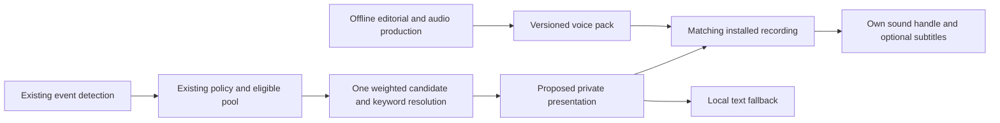

# RPHelper Forever: private voice feasibility

Research only, **2026-11-07**. Baseline: `feat/broad-ability-mappings`, commit
`a3e8ba989805113891d0991fef768be48512a672`. This document proposes a direction;
it changes neither the approved product policy nor the current implementation.
Read the [source study](voice_addon_architecture.md) for pinned upstream code,
and the [prototype](rphelper_voice_prototype.md) for a bounded next decision.

## Executive decision

1. **Technically established:** existing Forever-targeted addons play installed
   recordings locally with handles, stop controls, separate packs and subtitles.
   RPHelper already has selection, IDs, keyword eligibility and character
   settings that can remain useful. Playback does not inherently require chat.
2. **Uncertain:** permission and audibility from RPHelper's exact event contexts,
   cold-cache delay, sound-channel interactions, eighteen acceptable identities,
   complete asset rights, and audio coverage of dynamic/custom wording.
3. **Feasibility:** a private voiced core experience is credible without a
   gameplay companion. Complete natural prerecorded coverage of arbitrary names,
   user text and unrestricted templates is not a finite asset problem.
4. **Preferred architecture: C, a prerecorded core with explicit text fallback.**
   Offer character packs and a shared narrator; optionally consider client-native
   TTS or an offline custom-pack authoring tool later. Neither is required during
   normal gameplay. This is a recommendation for human review, not approval to
   change the default output route.
5. **Before building broadly:** validate local playback/stop/mute on Interface
   16001, listen to four prototype identities across sessions, approve narration
   scripts and asset rights, and verify missing/stale recordings never alter
   reaction selection or lead to public transmission.

## Reuse the engine, separate the presentation

The proposed private mode would retain the chosen reaction, its original type
and ID, effective weighting, event chance, cooldown, Priority, quota, Druid Say
suppression and raid/unknown-activity suppression. Public dungeon Custom Emote
success is accepted as **owner-reported evidence from this request**; it does
not imply audio permission or require public chat in a future private mode.
Existing open-world fallback is not silently reclassified as spoken audio.

No generation request, network bridge or public-chat output is needed on that
playback path. Audio availability should not filter or reroll the content pool:
that would quietly change weights and preferences. A missing recording should
present the same selected reaction privately, with an honest reason. A future
bounded scheduler must distinguish admitted/queued, started, failed, stopped,
finished and text-fallback states; `PlaySoundFile` success is not a listening
confirmation. Start with no long backlog: stale combat remarks lose context.

### Character speech: eighteen profiles

Use an explicit, versioned race-token/sex-value → internal profile mapping,
including `tauren_male`, `orc_male`, `nightelf_female`. Obtain readable player
values through the existing adapter; do not infer them from localized labels,
character name, faction or NPC models. Unknown/unavailable values yield text.
A stored user override could be a future product option, not a change here.

The current `Core/Content.lua` lists **eight** race layers, not nine. Skyborne
is the ninth proposed production family; Blizzard's
[Skyborne announcement](https://worldofwarcraft.blizzard.com/en-us/news/24302071)
identifies the new race. LoreForever's pinned `ModelRaces.lua` also identifies
Skyborne models, but neither proves RPHelper's player-token handling. Verify
actual `UnitRace`/`UnitSex` results before adding a ninth mapping; do not assume
existing UNDEAD naming, or a model-file label, equals the client's player token.
No race content or token mapping was added by this study.

A recognisable identity requires a stable provider voice identifier, recorded
reference takes, delivery/pronunciation notes and auditioning. Descriptions such
as “resonant adult voice, restrained pace” are direction, not an acoustic
identity. Race-appropriate characterisation should avoid caricatures and any
imitation of identifiable actors or existing character performances.

### Narration: explicit scripts, one shared identity

Treat stored third-person emote text as source material, not automatically
speakable second-person prose. Author a sidecar narration script per reaction
or constrained template, tied to its source version. For the supplied example,
“plants his hooves and calls upon the storm” can have an approved “You plant
your hooves and call upon the storm.” An arbitrary player sentence can contain
nested clauses, named speakers, possessives, tense changes or quoted dialogue;
replacing `his` and deleting `s` cannot solve that grammar.

Player pronouns can often disappear into fixed **you/your** narration. Anatomy
and cultural details still belong to the right race layer. A shared narrator
means one recording reused wherever the script and context actually agree;
it does not mean rewriting all characters into the same physical actions.

A target or pet name has no bounded pronunciation/file inventory. Only speak it
when a permitted, reliable snapshot and a recording/TTS result actually match
that name. The present ability context does not establish a reliable cast
recipient just because a target exists. Unavailable required context continues
to make an entry ineligible. If context is valid but audio is absent, show the
resolved text; never read braces, guess a target, or silently substitute another
entity. A separately approved generic narration variant would be a new
editorial choice, not automatic placeholder repair.

### Ordinary Emotes

`DoEmote` / `C_ChatInfo.PerformEmote` are native-emote routes, with the unresolved
return/permission limits recorded in [the emote test](../emote_output_test.md).
They may have public text/animation/sound side effects. They therefore cannot
be called by default while promising **no automatic public transmissions**.

Keep native emotes as a separately evaluated, explicit future option. Test the
actual token, animation, local sound, nearby-player effects and restrictions.
`PlaySound` can play a known game sound locally; it is not a universal token →
private character animation API. A local PlayerModel animation would affect a
UI model, not establish private animation of the actual character. No such
private in-world mechanism was proven here. Do not narrate `LAUGH` or `ROAR`.
An authored action subtitle or deliberately designed local cue could be a
future presentation; until approved, retain an explicit text-only outcome.

## Dynamic-content coverage

| Content feature | Feasible approach | Limit / proposed fallback |
| --- | --- | --- |
| Fixed built-in Say | Full recorded sentence for each applicable profile | Match ID, text version, language and profile; no match → same resolved local text. |
| Player-created reaction | Optional offline authoring/export/generation and installed personal pack | No automatic in-game synthesis in A. Edits invalidate prior audio. Text remains functional without tools. |
| Small numbered template | Record every concrete sentence, retaining the exact random choice | Affordable for small finite products; no extra random draw to pick audio. |
| Large finite template | Curate a bounded audio subset or deliberately redesign later | Hundreds of takes per profile can dominate work. An uncovered chosen variant remains text; no reroll. |
| Fixed player pronouns | Controlled variants, or explicit you/your narration | UnitSex is not a license to infer an arbitrary person's pronouns. Apply only the existing approved player semantics. |
| Dynamic names/world text | Text fallback; optional native TTS after verification; offline take for a specifically bound string | Cannot prerecord all future names. Never speak unresolved or secret values. |
| Segment assembly | Possible to schedule installed fragments with durations | No phonetic concatenation/seek API demonstrated; joins, coarticulation, stress, pitch and timing harm immersion. Short prefixes plus arbitrary names still require the name audio. |
| Random insults | Text fallback or an explicitly budgeted subset | Fragment products and names can multiply coverage. Do not mistake finite source fragments for low production effort. |

The engine selects each repeated numbered placeholder once per expansion.
Offline enumeration must use unique referenced slots, not count the same slot
again every time it occurs. Keyword resolution and secret-value checks precede
matching a recording. Subtitle text must match what is heard; a frozen generic
audio sentence must not be displayed as though it spoke the actual target name.

For edited reactions, the same ID is insufficient. A proposed asset index can
associate `(reactionID, profile, language, concrete variant)` with the exact
source/display text, approved audio script, revision/fingerprint, path and
duration. Build-time hashing and runtime exact matching avoid requiring a new
cryptography library. Narration needs its own script revision. Do not
aggressively normalize away meaningful names or punctuation for matching.
Voice model/provider updates also require a new voice-production version.

### Native TTS and external offline authoring

The inspected Forever `C_VoiceChat` documentation exposes text-to-speech APIs;
see [source evidence](voice_addon_architecture.md#shared-conclusions-and-forever-api-boundary).
They may handle resolved custom text without a separate player application,
but available OS voices, rate/volume semantics, interruption scope, combat
permission and offline behaviour are live-test questions. Native TTS cannot
inherit the generated fantasy voice identities, and a global stop could disturb
accessibility speech. It should be opt-in and isolated, not a hidden switch
from a character voice to an unrelated system voice.

An **offline** pack tool is different from a gameplay companion. It could read
an explicitly exported text snapshot, validate scripts, generate/record audio
outside WoW, compile a data-only pack, and require installation/restart. It
must not require live access to protected game values or put credentials in an
addon. WoW does not become an arbitrary HTTP client or filesystem writer by
installing a voice addon. SavedVariables are not a reliable live IPC stream;
normal persistence occurs on reload/logout. This study supplies no live bridge.

## Inventory and storage model

The existing exporter was invoked through its read-only `collect()` and
`build_inventory()` functions; production registrations were loaded by its
harness without SavedVariables or runtime initialization. Results match the
canonical CSV. Historical `RPHelper/` source paths in the CSV are normalized by
the existing exporter, not rewritten here. Source: [exporter](../../scripts/export_content_inventory.py),
[canonical reactions](../content_inventory/reactions.csv).

| Layer | Say | Custom Emote | Ordinary Emote |
| --- | ---: | ---: | ---: |
| General | 87 | 65 | 3 |
| Race, eight populated layers | 165 | 40 | 5 |
| Class | 289 | 65 | 33 |
| Druid Form | 0 | 29 | 3 |
| Ability | 500 | 268 | 15 |
| **Total** | **1,041** | **467** | **59** |

This is the complete catalogue, including entries whose detectors are not yet
implemented. It is not the count of reactions currently reachable in gameplay.
Speech cost belongs to **1,041 Say rows and eligible narrated scripts**, not all
1,567 rows multiplied by eighteen. Ordinary Emotes need no TTS files by default.

Say allocation is 87 broadly reusable lines, 165 race-restricted rows, and 789
class/ability rows. The class/ability Say counts are DRUID 18, HUNTER 145,
MAGE 109, PALADIN 82, PRIEST 122, ROGUE 41, SHAMAN 181, WARLOCK 79, WARRIOR 12.
Race-specific Say rows: Dwarf 20, Gnome 22, Human 18, Night Elf 17, Orc 19,
Tauren 24, Troll 23, Undead 22. A race's line needs its own two voices, not all
other races' voices. A class line is recorded only for races that can use it.
A complete Forever race/class matrix was not verified here: do not substitute
a Retail or vanilla matrix to turn an estimate into a “precise” total.

Let `R_c` be the number of applicable races for class c. A one-take-per-row
planning baseline, **before dynamic variants**, is:

`N = 18 × 87 + 2 × 165 + Σ(2 × R_c × classSay_c) + 467 narrator takes`.

For sensitivity, a weighted average of five applicable races per class gives
**10,253** files. This is a storage assumption, not a claim about legal class
combinations. Recording every class line for all nine races is an intentionally
broad ceiling of **16,565**, still far below `1,567 × 18 = 28,206`. Both baselines
assume an approved single narration script per Custom Emote; neither solves
arbitrary names, unlimited custom content or template products.

### Actual template/dynamic burden

- **932 Say rows have literal, keyword-free text**; the other 109 include ten
  numbered templates and other dynamic wording.
- Five racial templates have respectively 16, 6, 12, 18 and 12 combinations:
  **64** sentences across those five IDs.
- Two Warlock templates each have 180 combinations but contain `{NPC}`; they
  are not fully prerecorded sentences without entity context.
- Warrior absorb has **216** combinations. Two Warrior insult IDs each have
  **112** combinations with the same text product; one recording set per
  applicable profile could serve both IDs. The unusually long absorb alternative
  also makes a fixed three-second average inaccurate for exhaustive coverage.
- Enumerating the ten templates, then excluding every remaining braced keyword,
  yields **1,436 literal Say variants**. Replicating only racial lines twice and
  other lines across all eighteen profiles gives 22,280 references, or **19,958
  recordings after exact-text reuse within each profile**. These are a broad
  coverage ceiling, not a validated class-aware release list.
- **294 Custom Emotes are keyword-free**. Another 56 use only fixed player
  pronouns, giving **350 candidate scripts** for controlled you/your narration.
  The other **117** need contextual names/values. Even the 350 require editorial
  script approval, not automatic third-to-second-person rewriting.

These figures explain why full template recording can exceed a one-take-per-ID
budget. A realistic initial release should leave uncovered variants text-only.
Keeping separate IDs while sharing identical audio preserves configuration.

### Three distribution-quality scenarios

Assumptions: one approved take per planned row/profile, Say **3 seconds**,
narration **4.5 seconds**, mono speech, plus **8%** for short-file/container and
index budgeting. The observed unexpanded text averages are about 5.66 Say words
and 8.30 Custom Emote words; durations include delivery/silence margin. No audio
was encoded or measured. VBR averages and ZIP savings must be measured later;
ZIP does not substantially compress already compressed speech.

`seconds = 3 × Say recordings + 4.5 × narrator recordings`

`MB = seconds × nominal_kbps / 8 / 1000 × 1.08` (decimal MB).

| Planning coverage | Files | Recorded hours | Compact Vorbis, nominal 48 kbps | Balanced MP3, 80 kbps | High MP3, 128 kbps |
| --- | ---: | ---: | ---: | ---: | ---: |
| Current, class-aware assumption | 10,253 | 8.74 | 204 MB | 340 MB | 544 MB |
| Current, all-class/profile ceiling | 16,565 | 14.00 | 327 MB | 544 MB | 871 MB |
| 2,361 expansion, class-aware assumption | 15,440 | 13.16 | 307 MB | 512 MB | 819 MB |
| 2,361 expansion, all-class/profile ceiling | 24,944 | 21.08 | 492 MB | 820 MB | 1,311 MB |

The expansion is an explicit **projection**, not an inspected editorial plan:
131 broad Say + 249 racial Say + 1,188 class Say + 704 Custom Emote + 89 ordinary
Emote = 2,361 rows, approximately the current mix. Replace these assumptions
when an approved expansion inventory exists. Template alternatives can increase
these budgets; duplicated text and excluding unreachable detectors can reduce
them. Unbounded names cannot be covered by any finite multiplier.

A 44.1 kHz/16-bit mono PCM master is 88,200 bytes/second: approximately 2.77/4.44 GB
for the two current scenarios, 4.18/6.69 GB for the projections, before archival
compression. Keep lossless masters outside player packs. Upsampling a lower-rate
source does not restore detail. MP3/Vorbis have upstream shipping evidence;
these sizes do not assert WAV playback compatibility in Forever.

For a player installing **one character profile plus one shared narrator**,
the balanced current baseline is approximately **40–52 MB** averaged across
races, rather than 340–544 MB for the entire set. The class-aware average uses
`87 + 165/9 + 789×5/9` Say lines, plus the shared 467 narrator lines. Individual
races/classes, finite templates and pack subdivisions change that figure.

Prefer separate downloadable character packs and a narrator pack, with a tiny
base addon and explicit language/version metadata. A character profile can
contain only applicable class groups; a shared narrator is never duplicated
inside eighteen character packs. Package one listening-tested quality first:
three simultaneous public quality tiers multiply support/update work. These
three scenarios are comparisons, not a recommendation to ship all three.

## Architecture comparison

| Criterion | A: all prerecorded assets | B: external TTS companion | C: prerecorded + explicit alternatives |
| --- | --- | --- | --- |
| Immersion / identity | Strong after editorial QA; fixed takes | Potentially consistent model voices, but variable latency/delivery | Same quality for covered built-ins; clear text fallback for others |
| Forever feasibility | Installed-file playback has source evidence | Needs a permitted, reliable bridge and external audio process; not established here | Same proven playback foundation; native TTS remains optional/unverified |
| Gameplay offline operation | Installed assets require no voice service | Only if a local model and bridge are available; cloud TTS needs network | Installed recordings/text work without voice service or companion |
| Installation | Addon plus selected packs | Addon, app, permissions, model/service setup and possibly keys | Addon plus packs; optional authoring tool used outside gameplay |
| Size | Largest if attempting broad coverage | Small addon; local models may be much larger than packs | Controlled pack size; missing content does not force downloads |
| Maintenance | Script, asset and text-version synchronization | All of A plus bridge/app/provider lifecycle | Versioned fixed assets and honest coverage; bounded authoring workflow |
| Custom reactions / names | Finite exact prebuilt strings only | Dynamic synthesis possible if readable text reaches it legitimately | Text always available; offline personal packs or opt-in native TTS later |
| Performance | Disk/decode startup and local queue | Generation/bridge/network latency plus external CPU/GPU | Local lookup/playback, predictable text fallback |
| Licensing / distribution | Source text, voice and audio rights must be cleared | Also model weights, service, voice cloning and companion licenses | Same asset rights; no need to redistribute another addon's voices |
| Restriction risk | Low if limited to readable values and local APIs; still test | Bridge and secret handling add unverified constraints; no memory/injection workaround acceptable | Low core exposure; private fallback never escalates to public chat |

**Recommend C with text fallback as the required alternative.** A mandatory
external companion fails the no-external-application gameplay requirement.
Native TTS may be a later accessibility option; it is not needed to make C
useful. Broad all-audio coverage should wait for listening and content-rights
results, not merely a successful API return.

## OpenAI speech generation: current feasibility

This section uses official OpenAI documentation, checked **2026-11-07**; no
account eligibility, service request or paid generation was tested.

**Important lifecycle change:** the official [TTS guide](https://developers.openai.com/api/docs/guides/text-to-speech)
and [deprecation notice](https://developers.openai.com/api/docs/deprecations)
state that `tts-1`, `tts-1-hd`, and `gpt-4o-mini-tts` shut down **January 6, 2027**.
The documented replacement uses the Realtime workflow; changing a Speech endpoint
model string to `gpt-realtime-2.1-mini` is unsupported. Do not base a long-lived
production pipeline or current cost claim on old TTS tutorials/prices.

| Question | Assessment |
| --- | --- |
| Stable voice selection | Named built-in voices are selectable, but a prompt alone does not lock timbre. Current [custom-voice documentation](https://developers.openai.com/api/docs/guides/custom-voices) supports saved prompt-generated voice IDs for GPT-Live; reuse the saved ID across sessions, not a newly generated description. |
| Eighteen identities | The documented 100 prompt-voice organization limit can accommodate eighteen characters plus a narrator. Prompt-generated voices currently work **only with GPT-Live**, not Speech/Realtime/Chat audio. Capacity is not proof that nineteen voices will sound distinct or remain artistically consistent. |
| Recorded-reference voices | Separate eligibility-limited workflow with matching speaker consent/sample recordings. Do not presume access or clone recordings downloaded from these addons. |
| Delivery / pronunciation | Keep voice descriptions and performance instructions separate; maintain a reviewed lexicon and reference takes. No documented guarantee here of byte-identical output, exact phoneme control, or perfect script adherence. Audition recurring fantasy names, whispering, exertion and short exclamations. |
| Reproducibility | Preserve accepted audio bytes and hashes, voice ID, model/version, instructions, exact script and processing settings. Regeneration is a new take requiring review. |
| Batch production | An offline worker can process a manifest in bounded jobs with retry/cost accounting. The [Batch API endpoint list](https://developers.openai.com/api/docs/guides/batch) does not include Speech or Live; do not assume Batch pricing or submit unsupported jobs. |

For a current saved-prompt-voice experiment, **GPT-Live is an offline production
candidate**, not a WoW integration. [Session documentation](https://developers.openai.com/api/docs/guides/live-conversations#download-a-recording)
describes finalized stored-session downloads as stereo WAV (input left/output
right). Production would isolate the output, trim audited takes, verify the
spoken words and transcode to a tested game format. Live is conversational;
verbatim short-line production reliability is a prototype question. Realtime's
documented migration path is a separate option; it cannot use prompt-generated
Live identities interchangeably.

The legacy Speech interface documents MP3/Opus/AAC/FLAC/WAV/PCM exports; that is
an API output list, not a WoW decoder list. Preserve lossless production sources
when available and use tested MP3/Vorbis derivatives for installation.

### Cost estimates, not authorized spending

[Current pricing](https://developers.openai.com/api/docs/pricing) lists GPT-Live 1
at **$0.05 per active session minute**, billed per second; backend models/tools
are additional. Thus the class-aware/all-profile current baselines above have
voice-session **speech-time floors of $26.22 / $42.00**; the projected expansion
floors are **$39.48 / $63.24**. Real session time includes gaps, auditions,
corrections and rejected takes. A rough 2–4× production allowance gives
**$52–168 current** or **$79–253 expanded**, before backend charges and human
editing. These amounts do not cover exhaustive templates or arbitrary names.

This is session pricing, not a promise of $0.05 per finished audio minute or a
quote for a future discontinued Speech model. The same official page lists
Realtime mini audio output at $20/million tokens, with other token categories
charged separately; translating it into dollars/minute without measured usage
would be speculative. Recheck model access and pricing before any production
purchase. No ongoing OpenAI charges are needed to play installed recordings.

### Rights and creative constraints

OpenAI's guide requires synthetic-origin disclosure and leaves output rights to
the applicable agreement; voices need not be unique. This does not clear
RPHelper text or third-party speakers. Retain required provenance and review
the actual account agreement and provider conditions before redistribution.

The immediate project-specific issue is [CONTENT_RIGHTS.txt](../../CONTENT_RIGHTS.txt):
inherited creative reaction text is explicitly **excluded from RPHelper's MIT
grant** and does not have independently established redistribution/adaptation
permission. Producing voiced derivatives does not remove that issue. Clear
selected text and narration adaptations before a publicly distributed pack;
keep contributor attribution and obtain explicit recording/synthetic-voice
permissions where needed. Do not copy default LoreForever audio, Spoken packs,
actor voices or copyrighted character performances for this project.

Tools also have separate licenses: upstream code MIT does not license bundled
libraries, FFmpeg build components, encoders, hosted TTS terms, or model weights.
A future pipeline must record the actual tool/build and asset grants it uses.
Use original adult fantasy-inspired vocal direction and a clear AI-audio notice
for AI-generated packs; owning the output is not a warranty of uniqueness.

## Decisions required after the prototype

The private-only default, native Emote treatment, identity override controls,
narration scripts, custom-content fallback, pack distribution and content rights
need human approval. First test ordinary automatic local playback, mute/stop,
short-line quality and cross-session voice identity. A convincing four-voice
prototype would justify phased pack production; failure on those fundamentals
would favour improving the existing private text experience before committing
to eighteen profiles.
