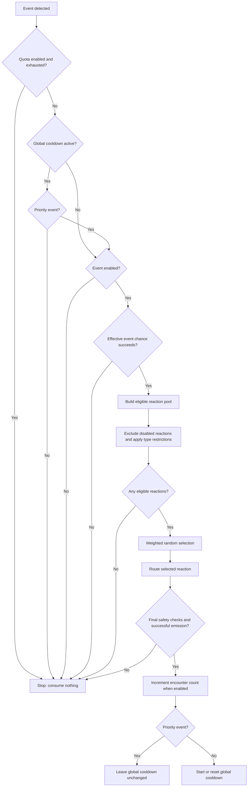

# V1.0 UI/UX Specification

## Status and scope

This document defines the approved V1.0 user experience. The first UI milestone
implements the addon-owned window, approved navigation, and the Main tab's global
settings and policy text. Milestone 2A adds character-specific Generic, Race, and
Class library browsing plus individual reaction activation. Milestone 2B adds
event/ability settings, 1–10 weights, Custom CRUD, independent Built-in copies,
and private preview. Final Guide/About content remains a later milestone. The
controls use the implemented schema-v2
persistence and runtime-policy model defined in
[SavedVariables Architecture](savedvariables_architecture.md). Development-build
settings are not a supported migration source.

The UI is character-specific. It does not provide account settings, profiles,
import/export, or character-to-character sharing. Final labels and explanatory
copy are provisional and require editorial review before release.

## Navigation

RPHelper uses one addon window with three top-level tabs:

1. **Main** — frequency, safety restrictions, and library entry points.
2. **Guide** — a short plain-English reference.
3. **About** — purpose, credits, links, and version information.

The window remembers no account-wide state. Opening a library or editor creates
no runtime reaction and does not transmit chat or emotes.

## Main tab

### Frequency and safety

The top of the Main tab contains:

- **Reaction chance** — integer percentage slider from 0% to 20%, default 5%.
  It is the baseline chance for an event that has no explicit event-level chance.
- **Cooldown** — integer-seconds slider from 5 to 120 seconds, default 20
  seconds. It is the only configurable cooldown. Only a successfully emitted
  non-priority reaction starts or resets it.
- **Encounter quota** — off by default. Enabling it reveals or enables an
  integer control from 1 to 10, with 2 retained as its default value. When off,
  no encounter-count cap applies; other chance, cooldown, and output policies
  still apply. Every successfully emitted reaction counts, including priority
  reactions, and the counter resets at the beginning of a new encounter.

### Reaction Output

| Environment | Say | Emote | Custom Emote |
| --- | --- | --- | --- |
| Open world | Local-only output | Native WoW emote | Native `/e`-style emote |
| 5-player instance | `/say` by default; optionally local-only | Native WoW emote | Native `/e`-style emote |
| Raid | Disabled | Disabled | Disabled |

One per-character control applies only to Say reactions in 5-player instances:

- **Broadcast in /say** — shipped default.
- **Local display only** — optional explicit preference.

“Local-only” means RPHelper UI/chat-frame text visible only to the player. It is
not a game chat broadcast and is not a character-attached speech bubble. True
character-attached local bubbles remain a technical objective pending Forever
client verification and are not promised for V1.0.

Below it, show two informational policy statements, not checkboxes or settings:

**Raid-safe behaviour**

> All automatic reactions are disabled while in a raid.

**Druid form behaviour**

> Speech reactions are suppressed while shapeshifted. Emotes remain available.

These policies cannot be unlocked or overridden through SavedVariables or UI.

### Character library

The character library has three sections:

- **Generic** — reactions available regardless of race or class.
- **Race** — reactions for the current character's race.
- **Class** — reactions for the current character's class.

Each section shows a short content summary and two actions:

- **View** opens the shared library in browse mode.
- **Customize** opens the same library with customization actions visible.

A prominent **Add Custom Reaction** button appears after the three sections. It
opens a blank reaction editor, beginning with library section and event selection.

The three sections are filters over one interface, not separate editors. Existing
ability and Druid-form custom records remain valid SavedVariables data, but V1.0
does not add separate player-facing Druid-form library categories.

## Shared library interface

### Layout

The library contains:

- a back action returning to Main;
- the active section (Generic, Race, or Class);
- an event selector or event list;
- an event header with event activation and advanced settings;
- a scrollable reaction list;
- Built-in and Custom labels or filters;
- an **Add Custom Reaction** action scoped to the selected event.

The interface should preserve the selected section, event, and scroll position
when returning from an editor during the same window session.

### Event selection and controls

Selecting an event shows all applicable reactions in the active library section.
Each event has:

- an enabled/disabled control applying to the whole event;
- an optional **Event chance** from 0% to 100%; when present it replaces the Main
  reaction chance for that event, and “Use global chance” deletes the override;
- a **Priority** flag.

The chance slider selects whole percentages. An existing valid fractional
percentage is shown as stored precision and remains unchanged when another
event setting is saved; moving the slider explicitly replaces it with the
selected whole percentage. Clearing an override immediately shows the current
effective Main reaction chance it will inherit.

Saving event or ability settings writes only controls deliberately edited in
that session. Untouched effective defaults are not materialized, while a player
who explicitly edits a control back to its shipped default records that choice
so a later addon-default change does not replace it. Existing untouched
overrides and unknown metadata remain unchanged.

Event chance and priority belong to the event, never an individual reaction.
Priority bypasses the global cooldown only. It never starts, resets, extends, or
otherwise modifies the cooldown timer. It still respects chance, encounter quota,
enabled state, reaction eligibility, and output restrictions.

Tooltip:

**Priority Event**

> Priority events ignore the global cooldown, but still respect reaction chance,
> encounter quota and other restrictions. If the encounter quota has been
> reached, priority events cannot produce additional reactions.

### Reaction rows

Every row shows its type, a concise content summary, active state, and integer
weight. Built-in and Custom origins are unmistakable.

- Disabling a Built-in reaction records its permanent built-in ID; it never
  edits shipped content.
- Built-in content is read-only. **Create modified copy** opens a new Custom
  reaction based on it. Saving the copy does not change the source activation,
  weight, preferences, or catalogue content.
- Custom reactions can be activated/deactivated, edited, deleted, and previewed.
- Weight belongs to the individual reaction. It is an integer relative weight
  from 1 through 10 among eligible reactions for that event; default weight is
  1. Zero, negative, fractional, string, NaN, infinite, and greater-than-10
  values are invalid. Disabled and ineligible reactions do not participate.

The implemented library separates **View** inspection from **Modify** actions.
It exposes activation, weighting, event settings, private preview, Custom
creation/editing/deletion, and modified Built-in copies.
Destructive deletion requires confirmation and does not recycle the custom ID.

### Weighted selection

Weights affect only selection among candidates that remain after scope,
activation, template/keyword, and Druid-form eligibility checks. They do not
change event chance, cooldown, priority, quota, or routing. A weight of 2 gives a
reaction twice the selection weight of a reaction with weight 1; it does not
guarantee output or a fixed percentage over a small sample.

Weighted selection is implemented in the shared runtime content path after
eligibility filtering.

## Approved reaction-processing flow

Raid suppression occurs before this pipeline. Automatic raid reactions never
enter it. For permitted environments:

The effective event chance is its explicit 0–100% override, or otherwise the
global 0–20% chance; the two are never multiplied. Pool construction occurs only
after the chance roll succeeds. Druid Say suppression is applied while building
the pool; built-in and Custom Say reactions are treated identically. Emote and
Custom Emote remain eligible. Druid-form-specific built-in pools must not add Say
content. Output-time safeguards remain mandatory even after pool filtering.

Routing owns environmental behavior and final output safety. The reaction
pipeline does not repeat redundant activity checks. Every failure or suppression
consumes neither quota nor cooldown.

## Reaction editor

The editor is used for creating and editing Custom reactions. It shows:

1. library section and event;
2. reaction type;
3. type-specific content control;
4. active state;
5. integer weight;
6. validation feedback;
7. **Preview**, **Cancel**, and **Save** actions.

Changing section or event updates the custom scope. Built-in entries never enter
an editable state; “Create modified copy” creates a new custom record with
optional `sourceDefaultID` provenance.

### Reaction types

**Say**

- Free-text local speech content.
- Runtime routing remains context-aware: the editor does not promise that every
  automatic use will be publicly spoken.

**Emote**

- A standard Blizzard emote selected from a searchable catalogue; free-form
  tokens are not accepted by the editor.
- Search matches the localized display command/name and, where useful, the
  canonical token.
- Dispatch omits an explicit target so the game retains its ordinary current-
  target behavior. RPHelper does not select, clear, replace, or restore targets.

The current conservative editor offers canonical emote tokens already present
in the shipped authored catalogue and preserves a valid token already stored on
an edited Custom record. Expanding creation to the client's complete localized
searchable catalogue remains blocked on Forever catalogue verification.

**Custom Emote**

- Free-text `/e`-style action.
- The editor previews the character's name prefix but stores only the action
  text. The game/chat presentation supplies the character name; the addon must
  not persist a name-prefixed duplicate or add the name twice.

Current entry validation, supported placeholders, and safe resolution rules
remain applicable. Adding custom ability content does not create event detection
or a spell mapping.

Existing template/choice structures are preserved exactly. Because the bounded
V1 editor cannot faithfully round-trip arbitrary structured choices, template
content and type are read-only while activation and weight remain editable; the
UI states this limitation instead of flattening the authored data.

### Preview

Preview is always local-only. It uses the ordinary preparation path, including
template expansion, keyword eligibility, and Druid speech suppression, and shows
why a reaction cannot currently be prepared when practical.

Preview never calls `/say`, `/e`, a Blizzard emote API, or other public output;
never rolls event probability; and never records cooldowns or encounter quota.
Preview success does not guarantee a later automatic dispatch.

Unsaved editor text may be previewed through an isolated copy. Preview must not
write SavedVariables.

## Interaction flows

### Inspect a library

1. Open Main.
2. Choose Generic, Race, or Class.
3. Select **View**.
4. Select an event.
5. Filter or scroll through Built-in and Custom reactions.
6. Preview locally or return to Main.

### Customize an event

1. Choose **Customize** for a library section.
2. Select an event.
3. Enable/disable the event, optionally override its chance, or mark priority.
4. Enable/disable reactions and adjust their integer weights.
5. Resetting event chance deletes the character override and restores the global
   baseline.

### Create a reaction

1. Select **Add Custom Reaction** from Main or the library.
2. Choose section and event if they are not already supplied.
3. Choose Say, Emote, or Custom Emote.
4. Enter content or select an emote, set active state and weight.
5. Preview locally.
6. Save only after validation succeeds.

### Modify a built-in reaction

1. Select **Create modified copy** on the Built-in row.
2. Edit the new Custom copy without altering the built-in catalogue.
3. Preview and save.
4. Saving creates the independent Custom entry and leaves every source preference
   unchanged.

## Guide tab

The Guide is a brief plain-English reference covering:

- **Events** — game situations RPHelper can react to; a configured event is not
  necessarily detectable until its runtime support is implemented and verified.
- **Reactions** — sayings or emotes eligible for a selected event.
- **Reaction types** — Say, standard Blizzard Emote, and Custom Emote.
- **Built-in and Custom** — Built-in content ships read-only; Custom content
  belongs to this character and can be edited or deleted.
- **Creating reactions** — select a section and event, choose a type, enter or
  select content, preview locally, then save.
- **Frequency** — global chance controls how often eligible events try to react;
  an event chance overrides it, cooldown limits output frequency, and the
  optional encounter quota caps successful automatic outputs per encounter.
  Priority events bypass only the cooldown and still count toward quota.
- **Reporting issues** — include addon version, event, activity context, character
  class/race, steps to reproduce, and errors when opening an issue at
  `https://github.com/Wiubiki/rphelper-forever/issues`.

The Guide must not describe unimplemented event detection as available.

## About tab

The provisional About content includes:

- **Purpose:** “RPHelper adds occasional contextual character reactions to make
  roleplay feel more expressive without becoming spammy.”
- **Credits:** acknowledge Talyn and Overlord-Q as original RoleplayingHelper
  authors; mithyk and Syrsa as original content contributors; Duerma for
  RPHelper 2; Wiubiki for the Turtle WoW adaptation and WoW Forever rewrite; and
  retain further contributor acknowledgements as lineage is recovered.
- **Repository:** `https://github.com/Wiubiki/rphelper-forever`.
- **Ko-fi:** `https://ko-fi.com/V7V71A0D8Q`, visibly marked **pending policy
  verification** in this specification. It must not appear in the shipped in-game
  UI unless policy review affirmatively permits it.
- **Version:** addon version from release metadata, plus “pre-alpha” or another
  release-status label while applicable.

Final copywriting, capitalization, link presentation, and contributor wording
are provisional and require editorial review before release.

## Accessibility and error behavior

- Every slider displays its exact numeric value and supports keyboard adjustment
  if the client widget permits it.
- Color is not the only distinction between Built-in/Custom or enabled/disabled.
- Unconditional policies are presented as informational text, not disabled
  controls that imply they can be unlocked.
- Search and library empty states explain whether no content exists or filters
  removed all results.
- Validation errors appear beside the relevant field and do not destroy input.
- Unsupported or malformed saved records remain preserved and are reported as
  unavailable rather than silently repaired.
- Controls that cannot be safely saved because a container is malformed are
  disabled with recovery guidance.

## Persistence mapping

The intended schema-v2 mapping is:

- global chance -> `settings.reactionChance`;
- cooldown -> `settings.globalCooldown`;
- quota toggle -> `settings.encounterQuotaEnabled`;
- quota value -> `settings.maxAutomaticOutputsPerCombat`;
- dungeon Say destination -> `settings.dungeonSayMode` (`"broadcast"` shipped
  default or `"local"` explicit preference);
- event activation/chance/priority -> the event record under `triggers` (or the
  corresponding canonical event-settings collection decided during schema work);
- Built-in activation -> `disabledDefaults[permanentDefaultID]`;
- Built-in weight -> `reactionOverrides[permanentDefaultID].weight`;
- Custom active state and weight -> metadata on the custom record;
- content and scope -> the existing custom record `entry` and `scope` fields.

All fields are character-specific sparse explicit overrides. Reset removes the
leaf. Permanent IDs and V1.0-onward update guarantees follow the SavedVariables
architecture. A fresh V1.0 installation materializes none of these default-valued
leaves.

Raid suppression and Druid Say suppression are unconditional policies, not saved
settings. No schema-v2 fields can override them.

`reactionChance`, `encounterQuotaEnabled`, priority, reaction weights, and
`reactionOverrides` are implemented schema-v2/runtime fields. The Main settings
UI binds through the shared configuration API. Later library/editor work must use
the shared configuration and content-management APIs and requires no schema-v1
compatibility code.
